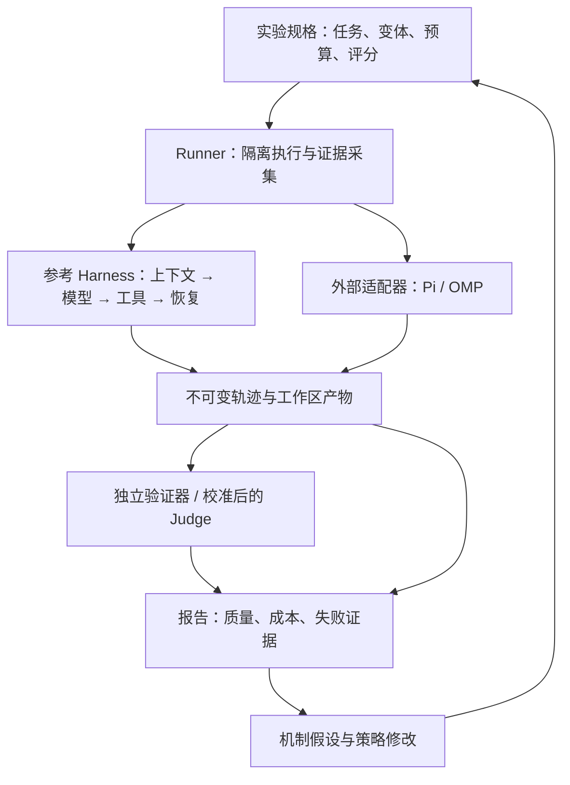

# Detroit — Coding Agent Harness 与评测实验平台

> 状态：M1 基础代码与确定性测试已建立，真实容器验收待完成；当前能力见 [docs/M1.md](docs/M1.md)
> 更新：2026-09-22
> 目标岗位：Agent Harness 开发 / LLM 评测工程
> 目标优先级：有实证的面试项目 → 个人自用 → 开源传播
> 本文仍是完整目标设计；已实现命令以 [README.md](README.md) 为准，实验规模与机制效果不代表实测成绩

## 1. 定位：用评测驱动 Harness 改进

Detroit 帮助开发者回答两个问题：日常任务应该使用哪套 agent 与模型配置；一次上下文或工具策略的修改，是否让 agent 更可靠、更省成本。

项目提供一个自己实现的轻量参考 Harness，以及 Pi / Oh-my-pi 外部适配器。它们在同一套任务、隔离环境和结果验证体系中运行，生成可追溯的质量、成本与轨迹报告。用户由失败轨迹提出机制假设，修改参考 Harness，再用受控实验检验效果。

完整产品路径是：选择任务和配置 → 运行 → 独立验证 → 比较报告 → 定位失败 → 修改策略 → 再评测。参考 Harness 是实验对象，评测器负责测量，报告把两者连接起来。

| 重点 | 需要亲手实现的机制 | 可以用证据回答的问题 |
| --- | --- | --- |
| Harness 执行 | 模型循环、工具协议、上下文构建、恢复与停止策略 | 模型输出怎样变成可靠执行？失败后为什么这样恢复？ |
| 上下文工程 | 预算分配、结构化压缩、来源追踪、过期检查与回读 | 长任务丢了什么信息？压缩节省是否抵得上质量损失？ |
| 评测工程 | 能力任务、独立验证器、judge 校准、配对比较与消融 | 分数测到了什么？提升来自机制还是任务、模型与评分偏差？ |
| 诊断与产品闭环 | 原始轨迹、实际输入、失败证据、版本化重评分、静态报告 | 能否从一次失败定位到下一项可检验的改进？ |

部署采用单机、单用户、模块化单体，运行于 Linux + 本地磁盘 + Docker。执行恢复和数据一致性是实验可信的基础，但主要研发投入放在上述机制与实证。首版聚焦 coding agent，结论范围也限定在所覆盖的任务上。

自用入口先是批次 CLI 和静态 HTML 报告。完整 TUI、IDE 插件、多租户、集群调度、训练平台、跨任务长期记忆与多 agent 协作均后置。开源价值来自易复用的任务、可检查的实验和清晰报告。

## 2. 技术选择与自研边界

| 组件 | 决策 | 理由与边界 |
| --- | --- | --- |
| 主体 | TypeScript + Bun | CLI、参考 Harness、runner、评测编排统一语言；方便接入 Pi/OMP，减少跨语言调试 |
| 模型接入 | Provider adapter + 官方 SDK | 先支持一个 provider；自己实现 agent loop，SDK 只负责模型请求与流式事件解析 |
| 存储 | `bun:sqlite`、WAL、显式 SQL 与迁移 | 保存实验与结果索引；单写入口、本地磁盘，短事务 |
| 证据 | 原始 JSONL + SHA-256 内容寻址产物 | 保存模型输入、工具输出、快照与判分依据；派生数据可重建 |
| 运行边界 | Docker + 独立 driver 进程 | 每个 attempt 独立环境；第三方 harness 可保持自身语言与 runtime |
| 契约 | JSON Schema + TS 类型、版本化 fixtures | 校验跨进程事件、工具参数与评分结果，避免只靠编译期类型 |
| 验证 | 独立 verifier 容器 + evaluator 插件 | 任务测试可以用对应项目语言；judge 作为主观维度的可选评分器 |
| 统计 | 先用 TS 实现简单配对汇总 | 需要成熟统计库时再增加 Python 分析脚本；原始表格始终可导出 |
| 展示 | 静态 HTML，内嵌对比、上下文变化和 diff | 无 API key 也能查看示例；交互 viewer 在实际需要时增加 |
| 工程验证 | `bun test`、`tsc --noEmit`、Biome、Docker 集成测试 | 重点测试模型/工具契约、上下文不变量和评分有效性 |

语言选择服务于岗位证据：主要难点在模型行为、上下文和实验设计，TS 能让这些机制在一套代码中迭代。Go 可用于未来明确需要的组件，目前不为展示语言能力增加一套控制层。

参考 Harness 自己实现调用循环、上下文策略、工具调度、恢复决策和事件记录；复用模型 SDK、容器、数据库、schema 库。若使用第三方 agent SDK 执行整个 loop，则该运行归入外部适配器，不能把 SDK 的机制记为自己的实现。

Harbor / Inspect 已有成熟 agent 评测能力，ATIF 已有轨迹交换格式。Detroit 的项目重点是可控 Harness 与评测之间的改进闭环；任务格式与导出优先参考已有生态。仅需跑现成 benchmark 时，直接使用现成框架成本更低。

## 3. 统一架构与领域模型



Runner 负责实验和环境，不代替被测 Harness 决定下一步行动。参考 Harness 与外部适配器接受同一执行契约；深层 context 观测是参考 Harness 的能力，不能假设外部产品都能提供。

| 实体 | 含义与身份 |
| --- | --- |
| Case | 版本化任务包：输入、初始环境、可见工具、验证规则、能力标签、来源与数据划分 |
| Variant | harness、模型、prompt、工具、上下文与恢复策略的冻结组合 |
| Experiment | 预设 Case 集、Variant 集、预算、重复次数、执行顺序、重试与统计规则 |
| Trial | 一次计划观测，唯一键为 `(experiment, case, variant, repeat_index)` |
| Attempt | Trial 的一次实际执行；基础设施重试新增记录，成本与失败历史始终保留 |
| Evidence / Projection | 不可变原始证据及其某版本的标准化视图 |
| Evaluation | 对指定证据的一版验证或评分，包含评分规格、结果与证据引用 |

共同不变量：实验规格冻结；实际配置另行记录；结束 attempt 不重新打开；未观测与零值分开；每个分数可追溯；执行结束、任务通过、评分器正常工作是三个独立维度。Trial 根据预设政策选定 attempt，不能重试后挑最好成绩。

## 4. 参考 Harness：可控的执行循环

参考 Harness 是能够读写代码、运行命令、接受任务内后续指令的 headless agent。首版只实现完成真实任务必需的能力，避免同时建设完整交互式 coding 产品。

```text
接收输入 → 写入原始 history → 检查停止条件
    → ContextBuilder 生成本轮输入 → ModelAdapter 发起调用
    → 汇总完整模型响应 → 校验工具调用 → ToolExecutor 执行
    → 写入结果与状态 → RecoveryPolicy 决定继续 / 修复 / 停止
    → 下一轮；无工具的最终响应进入结束流程
```

模块边界只放在需要替换、实验或隔离的位置：

| 模块 | 输入与输出 | 必须记录 |
| --- | --- | --- |
| ModelAdapter | 请求消息、工具 schema、生成参数 → 标准化响应 | 实际请求、provider 返回 ID、usage 来源、停止原因、错误 |
| ContextBuilder | 原始 history、当前状态、预算、策略 → 本轮 ContextView | 选入/移除的信息、摘要来源、估算 token、策略版本 |
| ToolExecutor | 已完整解析的调用 → 类型化结果 | call ID、开始/结束、结果来源、输出引用、副作用状态 |
| RecoveryPolicy | 错误类别、执行状态、剩余预算 → 下一项有界动作 | 决策理由、重试层级、次数、关联调用 |
| StopPolicy | 预算、进度、完成信号、取消 → 继续或结束 | `final_response / budget / deadline / stalled / error / cancelled` |

流式 tool arguments 只在响应完整并通过 schema 校验后执行；断流后的半个调用不执行。明确 SDK 自动重试政策，避免 adapter、SDK、runtime 各重试一遍。保留 provider 特有参数和 unsupported 能力，不能归一化后悄悄丢掉 reasoning、缓存或工具选择设置。

每轮提交的 messages、tools 和参数有不可变引用。这里的“实际输入”指 Harness 提交到 provider 边界的可见请求，不声称掌握服务端隐藏提示词、内部 reasoning 或处理过程。

停止依据是明确预算与行为信号。相同工具和参数反复出现且环境无进展时，先提供一次有界反馈，再按配置结束；正常重复读取不能直接当死循环。模型宣称完成仅是执行终止信号，最终是否成功由独立验证器决定。

## 5. 核心机制一：上下文构建与压缩

### 5.1 原始历史、工作状态与模型输入分离

- `RawHistory`：append-only 的用户输入、完整模型响应、工具调用与结果；大输出可存为产物引用。
- `WorkingState`：当前目标、约束、计划、已确认发现、待办与摘要；可更新，但每次更新有版本与来源。
- `ContextView`：某一轮真正发出的输入及构建 manifest。丢弃一段模型输入不会删除原始证据。

首版 memory 仅限当前任务。隐藏测试、标准答案和评分器反馈不进入可见 history；可见测试结果属于合法工具观测。实验阶段之间不继承个人会话、旧任务摘要或未声明的 skills。

### 5.2 预算与可替换策略

构建器满足 `输入估算 + 输出预留 + 安全余量 ≤ 配置上下文窗口`。输入包含系统提示、工具 schema、用户指令、摘要与工具结果；窗口上限与全任务累计 token/费用预算分别管理。

预先固定优先级：系统/工具契约与当前有效指令 → 活跃步骤依赖 → 最近完整交互 → 更早历史。受保护内容本身超出窗口时显式失败或按预设政策请求缩减，不静默丢约束。tokenizer 不可用时标记估算；收到 context overflow 只进行有界重建，不重新执行已完成工具。

实现三个可比较策略：

1. **保留完整历史**：在能容纳时作为参考；超过窗口则按声明规则结束，不能悄悄切换算法。
2. **完整交互滑动窗口**：保留相同固定指令与最近交互，按 tool-call/result 组移除旧历史。
3. **结构化压缩与回读**：压缩旧交互，保留目标、有效约束、发现及来源、待办和失败尝试，按需读取原始片段。

先采用确定性的选择与最近性规则，避免一开始加入向量库。若摘要使用 LLM，摘要模型、prompt、调用量、耗时和费用都属于 Variant 与总运行成本；压缩本身失败要有显式回退。

### 5.3 摘要的来源、有效性与回读

摘要条目包含 `kind / content / source_refs / observed_at / file_digest? / supersedes?`。运行时验证来源存在、引用范围有效、文件版本是否匹配；这些检查能证明来源和新鲜度，不能证明摘要语义一定正确，语义保真需要独立任务与人工抽查。

必须保持以下语义：

- 压缩仅在本轮工具均完成或被明确终结后进行。保留工具调用与结果配对；不能给模型留下找不到调用的结果。
- 用户修正以时间顺序和明确的 supersedes 关系更新有效约束；旧约束保留为历史。来源中的指令性文本仍按原权限处理，摘要不能把工具输出提升为系统指令。
- 文件相关结论区分“当时观察”与“当前有效”。文件变化后标记相关结论待复核，再读取当前内容，不能继续把旧摘要当现状。
- 大工具输出向模型返回有界预览及可回读引用；原文在任务生命周期内可通过受限 read-artifact 工具按范围取回，避免只有不可访问的摘要。
- 构建 manifest 说明保留、压缩、移除和失效的条目。未知的依赖关系不伪造为“已证明不会丢信息”。

关键测试围绕长链约束、用户纠正、文件更新、工具配对和来源可回读。真正的收益由第 10 节实验验证；压缩率更高本身不代表 Harness 更好。

## 6. 核心机制二：工具执行、恢复与停止

首批工具为 `read_file / search / apply_patch / shell / read_artifact`。每个工具声明参数 schema、输出上限、超时和副作用类别，返回 `ok / error / cancelled / unknown`、结构化错误及原始输出引用。`unknown` 表示执行结果无法确认，不能等同于未执行。

同一轮无依赖的只读工具允许有界并行，结果按 call ID 关联。写工具默认串行；读写混合批次按顺序执行，避免读到不确定版本。任意 shell 命令默认有副作用，不靠命令名字猜测是否只读。

| 失败类别 | 默认恢复策略 | 为什么 |
| --- | --- | --- |
| 参数不合法、未知工具 | 返回类型化错误，让模型有界修正 | 重发相同调用不能解决语义错误 |
| 明确未接受的限流、临时服务不可用 | 在所属层按上限退避，记录每次尝试 | 防止多层隐式重试与成本失控 |
| 模型请求断流且计费未知 | 不执行半成品工具；按政策决定是否重新请求 | 新请求可能再次计费，也可能产生不同输出 |
| 文件版本冲突、patch 前置条件不符 | 重新读取当前文件，再规划修改 | 旧参数重试可能覆盖新的内容 |
| 命令超时、退出回报丢失 | 终止进程组并检查副作用；无法确认则停止或显式恢复 | 命令可能已修改文件或提交外部操作 |
| 工具持续失败、无进展循环 | 有界反馈或 replan 后停止 | “多试几次”不能成为无限循环 |

`call_id` 用于本次进程内关联和结果去重，不能保证外部副作用 exactly once。参考工具可为写文件附预期 digest，并在可判定时检查目标状态；不可判定的 shell 操作不盲目重试。

预算包括模型调用次数、工具调用次数、累计 usage 和墙钟期限。参考 Harness 可在每次调用前检查已知预算；第三方 harness 能否逐请求控制由 capability 决定。费用/token 上限可能因在途请求、未知 usage 和计费延迟超出，标记为软约束；墙钟期限触发取消和有界强制回收，并记录实际停止延迟。

先用 scripted model 和可重置工具 fixture 验证错误路径，再运行真实模型恢复任务。故障按预设语义条件触发，记录是否实际暴露；不同 agent 未遇到同一故障时，不能直接比较恢复率。

## 7. 评测对象与数据集

### 7.1 三层评测共享同一结果模型

| 层级 | 固定什么、改变什么 | 回答的问题与边界 |
| --- | --- | --- |
| 模型能力探针 | 固定提示、schema、最薄执行循环，比较模型 | 参数遵循、工具选择、约束保持等能力；仍受提示与协议影响 |
| Harness 机制任务 | 固定模型、工具、任务，只改变一个策略 | 上下文压缩、恢复或并发策略是否有效 |
| 真实仓库任务 | 固定任务与资源政策，运行 Reference / Pi / OMP 组合 | 实际修复质量、成本与耗时，检验机制能否迁移 |

全部使用 Case / Trial / Attempt / Evaluation；模型探针只是工具与步数更受限的 Case。项目以机制任务和真实仓库任务为主，模型探针为失败假设提供补充证据。

固定模型比较 Harness，固定 Harness 比较模型；预算允许后做小规模 `模型 × Harness` 交叉实验，观察交互效应。完整产品比较保留各 Harness 原生 prompt、工具和策略，其结果属于组合表现，不能直接归因于某一组件。

### 7.2 从能力定义到可验证任务

| 能力 | 任务设计 | 权威验证与过程诊断 |
| --- | --- | --- |
| 长链信息保持 | 早期读到兼容性信息，经历多步搜索修改后验收 | 接口/行为测试；相关证据是否进入后续 ContextView |
| 用户纠正处理 | 任务内后续输入修订一项要求 | 按最终有效要求验证；检查旧要求是否被正确标为历史 |
| 状态与证据更新 | 关键文件变动后继续使用先前结论 | 当前文件/行为检查；旧摘要是否失效并回读 |
| 工具调用与恢复 | 参数错误、可重试读取、执行结果不明的写操作 | 最终状态与副作用次数；故障暴露、恢复动作和成本 |
| 真实代码修复 | 跨文件错误修复、测试补充、兼容性变更 | 独立隐藏回归测试、已声明的构建与产物检查 |

每个 Case 包含指令、初始代码与镜像 digest、依赖锁、可见资源、可选输入/故障脚本、验证器版本、能力标签、来源许可、split 和分组身份。后续输入按预设交互边界送达并保存回执，不能随意以耗时决定不同运行看到什么。隐藏验证只能检查任务已说明或所需保持的既有行为，不能引入未告知的要求。

先用少量高质量 Case 跑通，再按预算扩到约 20–30 个覆盖不同家族的任务；这是规划规模，不保证统计功效。使用已知正确解、常见错误解和有针对性的变异检查验证器，查找漏判、误判和 flaky 测试。

### 7.3 数据划分与污染控制

Harness 调参与 prompt 修改使用开发集；judge/rubric 调整使用人工标注校准集；最终效果在保留测试集检查。按仓库、模板与任务家族分组划分，并检查近重复，避免同一题改变量名后跨集合泄漏。

任务、标签、参考解与评分规则版本化；记录测试集查看和由此产生的修改。保留集用于调参后只能称回归集，需要新的保留任务验证泛化。公开任务可能被预训练见过，时间戳或内容 hash 不能证明无污染；报告披露这一限制。

合成机制任务利于控制变量，但需在真实仓库任务上验证迁移。少数模板生成的大量相似样例不能充当同等数量的独立能力证据。

## 8. 结果验证与 Judge 校准

### 8.1 独立验证优先

执行结束后停止 agent，采集评分需要的文件与状态，在新 verifier 容器中加载固定测试和产物。agent 可运行可见测试，但修改可见测试不能改变权威验证器；最终产物包含新文件、必要二进制与清单，不能只依赖 git diff。

验证器封装层把测试断言失败转成结构化 `fail`，测试命令的非零退出码不直接等于评分器故障；封装层崩溃、超时或结果格式错误记为 `evaluation_error`。结构化评分包含 `metric / value / status / evidence_refs`。更换验证代码、rubric、judge、输入截取规则或证据版本都产生新的 Evaluation。

主指标是任务是否满足要求。过程指标解释可能的瓶颈，例如无效调用、信息遗漏和无进展循环；不奖励与参考轨迹一致，不用调用次数或回答长度代理质量。隐藏测试的中间结果不向正在运行的 agent 反馈。

### 8.2 主观维度的评分器也要被评测

Judge 用于解释质量、可维护性等难以完全自动断言的维度，单独报告；确定性测试失败仍然是任务失败。可接入 Jev 或其他模型，但评分模型没有未经验证的权威身份。

上线 judge 的最小流程：

1. 明确 rubric、维度边界、正反例、平局与弃权条件，要求证据引用。
2. 人工标注覆盖不同模型/Harness、成功/失败和长度差异的样本；尽可能双人独立标注并保留分歧。若只有作者标注，明确标为单人参考标签。
3. 在校准集调 rubric，在独立人工标注保留集检查；报告样本量、混淆矩阵、一致率及适合标签尺度的一致性指标。
4. Pairwise 比较隐藏来源标识并交换 A/B 顺序，检查位置偏差、长度偏差、同源模型偏好和弃权率；脱敏无法保证完全消除身份线索。
5. 若给出概率或置信分数，单独检验校准；未经校准的自报置信度不直接作为权重。效果不足时只作辅助证据。

候选内容按不可信数据传入，保持 rubric 与任务指令的边界，检验 judge 对候选内指令的抵抗能力。记录 judge 模型、prompt hash、采样参数、证据选择策略、原始输出与费用；不同 judge 之间的一致不能替代人工效度检查。

失败归因可用 judge 生成候选解释，但“某次压缩导致失败”需要受控实验支持。模型自我解释不是不可观测内部过程的事实。

## 9. 实验有效性、统计与成本口径

Experiment 冻结任务/镜像 digest、模型与 Harness 版本、系统提示、工具/skills、上下文策略、恢复策略、权限、缓存、预算、重复次数、执行顺序、重试政策、评分和汇总规则。默认值运行前尽量解析，每个 attempt 另存 requested/effective 配置。

必要能力不满足时拒绝派发；配置漂移或模型 fallback 按预设政策标记无效，不能改原 Variant 身份后继续混算。同一 seed、temperature=0、相同模型名称都不保证输出确定；服务端快照不可固定时记录时间范围与限制。

设任务 i、variant v、重复 r 的结果为 `y(i,v,r)`，先计算每任务平均，再按预设权重汇总。A/B 比较先计算每任务差值。以任务为块交错执行 variants，随机化块内顺序，减少时段/负载差异。

置信区间默认按任务进行 paired cluster bootstrap，保留同一任务全部 variants 和重复；不能把每轮运行当作独立任务。存在共享模板/仓库的强相关时改用预设家族聚类或分层汇总；独立组太少时只报告描述统计与限制。重复次数、主比较和停止规则提前确定，不观察到显著后才结束。

| 指标 | 口径与必须披露的限制 |
| --- | --- |
| 主成功率 | 完整批次按预设任务权重汇总；预算耗尽、模型/Harness 错误及重试耗尽的运行失败计未成功 |
| 有效执行成功率 | 排除基础设施无效执行的辅助口径，同时展示排除原因与数量，不能替代主指标 |
| 未完成与评分故障 | 未执行、尚未评分、验证器故障分别列出；未解决时不发布完整最终分数 |
| 成本 | 按调用角色列主调用、压缩/辅助调用与 judge；另标记所属 attempt 是否重试，每笔费用只汇总一次 |
| 成功成本 | agent 全部实际 attempt 成本 / 成功 Trial 数；无成功时未定义，不能只统计成功样本花费 |
| 耗时 | 排队、准备、执行、评分分开；超时记录观察时长并标记截尾，不能假设其完成时间 |
| 过程质量 | 工具错误/有效调用、重复循环、信息保持、回读、恢复；标明分母、暴露条件和可观测范围 |

费用按 provider 实际 usage 与版本化价格表估算，区分缓存读写、输入/输出及 provider 特殊计费口径；不能把已包含在输出中的 token 再加一次。未知 usage 不记为零，只有部分已知时显示已知成本及覆盖率，不能据此断言完整成本更低。

多次独立重复用于估计随机性，主指标不挑最好一次。若以后报告 pass@k，必须明确它代表 k 次机会的效果、独立采样假设和总预算，不能替代单次任务能力。优化成本时同时报告质量差值与区间；声称“质量不降”需预设可接受差异与足够证据。

## 10. 首个深入实验：长任务中的信息保持

### 10.1 问题、假设与对照

研究问题：在相同模型、工具、上下文窗口和运行预算下，带来源与失效检查的结构化压缩，能否比滑动窗口更好地保持任务所需的信息，并改善最终完成率与成本？

具体 Case 示例：修改一个缓存库的淘汰策略并保持既有接口行为。早期读取的调用方与测试揭示“缺失键”和“值为 null”的区别；随后经历跨文件修改与长日志，要求模型最终保留兼容性。任务再设置文件更新和用户纠正子类，用来检查旧结论失效与有效约束更新。

显式用户要求和系统/工具契约对各策略采用相同保留规则；实验主要观察历史工具证据、依赖和状态的保留。不能通过故意给某个 baseline 隐藏必要输入制造优势。

| 变体 | 用途 | 需要控制的差异 |
| --- | --- | --- |
| Full history | 在窗口允许时提供参考，超限按声明规则结束 | 不作为无限窗口下的公平对手；扩大窗口另开实验 |
| Sliding window | 首要 baseline | 同样保留固定指令，按完整交互移除旧历史 |
| Structured compaction | 目标机制 | 压缩、来源、回读与失效检查的整体策略，所有辅助成本计入 |
| 无失效检查 / 无回读 | 后续单项消融 | 分别从目标机制移除一个组件，检验该组件贡献 |

主比较预设为 Structured vs Sliding；Full history 是辅助参考。先在开发集检查任务难度、预算和天花板/地板效应，再冻结测试规格。消融不同时更换模型、工具、prompt 主体或提高预算。

### 10.2 最小实验规格示例

下列 YAML 展示目标配置语义；数值仅供开发集试跑，不能直接当作合理样本量或最优预算。模型 ID、任务清单与版本需在实现后填入并冻结。

```yaml
name: context-retention-v1
suite: suites/context-retention/dev.json
variants:
  - reference/full-history.yaml
  - reference/sliding-window.yaml
  - reference/structured-compaction.yaml
primary_comparison: [structured-compaction, sliding-window]
repeats: 3
order: randomized-case-blocks
budgets:
  context_window_tokens: 16000
  output_reserve_tokens: 2000
  max_model_calls: 40
  total_model_tokens_soft: 150000
  wall_time_seconds: 600
retry:
  infrastructure_attempts: 1
scoring:
  primary: independent-tests-v1
  diagnostics: information-retention-v1
analysis:
  unit: case
  interval: paired-cluster-bootstrap
```

`max_model_calls` 和累计 token 包含压缩等辅助模型调用；`infrastructure_attempts: 1` 表示每 Trial 最多一次执行尝试。任务家族相关时，analysis 的聚类单位需在正式运行前改为家族。开发集试跑只用于可行性与费用估算；正式实验换成保留集清单并冻结规格，开发结果不混入测试成绩。

### 10.3 结果与证据要求

同时报告：最终通过率及差值区间、独立约束断言通过率、压缩前后可检索信息覆盖、无来源/过期摘要比例、回读量、累计 token、费用和耗时。每项过程诊断定义采样时点与分母；语义保真指标用可验证事实或人工标注校验。

M2 报告包含机制任务的全部测试 Trial 和失败样例；M3 补齐保留真实仓库任务上的迁移结果，此前结论限于机制任务。数据不足时结论可以是“目前未发现稳定收益”；不能把压缩节省直接写成整体质量提升。

仅有一条失败轨迹时，可说“关键信息在某轮输入中缺失，后续修改违反要求”。要检验机制贡献，需要受控对照与消融。若要从中间节点做反事实续跑，必须保存并恢复工作区、history、有效配置和工具状态，产生新的 branch/attempt 并记录新增费用；只改日志不能重现后续执行。首版以从相同初始环境重跑为主，中途分叉后置。

## 11. 轨迹诊断与版本化证据

共同事件字段为 `schema_version / attempt_id / source_id / source_seq / event_type / call_id / span_id / parent_span_id / observed_at / occurred_at? / raw_ref`。参考 Harness 记录 model、tool、context-build、compaction、recovery、steering、stop；外部适配器记录原生可见事件，按维度声明完整度。

原始 JSONL 与内容寻址产物不可变；normalizer 根据输入 digest、代码版本和参数生成 Projection。一个原始事件可映射多个标准事件，ID 含投影版本与稳定位置；相同来源序号不同内容是冲突。来源内顺序与调用关系表达因果，接收顺序不冒充全局执行顺序。

Token 归属于模型调用，明细与汇总不重复相加；usage 标注 provider/harness/estimated 来源。并行工具 span 耗时与运行墙钟时间分别展示。ATIF 用于交换可映射部分，并附映射损失说明；未知外部行为保留 unknown。

静态报告的核心诊断页面包含：

- 任务要求、最终产物、独立验证失败断言与代码 diff。
- 每轮模型输入和工具响应；压缩前后信息差异、来源、文件版本与回读入口。
- 预算消耗、错误与恢复决策；模型、工具和上下文事件的关联时间线。
- 失败解释的证据引用与观测限制，随后可生成的策略变体与实验规格。

报告先提供规则可确认的事实，再展示人工或模型的候选解释，不把相关性自动标为根因。原生日志与 agent 自报事件也不是独立审计事实，最终结果依赖产物验证。

重新 normalize / score 使用保存证据，保留多版结果；judge 重评分可能新增评分费用，但不重新调用被测 agent。历史浏览、重新判分、重新执行分别命名。分享报告导出脱敏副本，对日志内容做 HTML 转义并保留原始证据本地引用。

## 12. 运行底座与外部适配协议

### 12.1 生命周期与隔离

首版 CLI 内嵌单个 coordinator，每个数据目录持有单实例锁，runner 使用有界进程池。一次 attempt 对应一个带身份标签的容器，生命周期为 `queued → preparing → running → collecting → finished`；任一活动阶段都可转为 `error / timed_out / cancelled / interrupted`，清理状态独立记录。

每次执行从固定镜像和初始文件开始，配置目录、memory、skills 与缓存政策显式指定。限制 CPU/内存/PID、网络和执行时间；不挂载 Docker socket、宿主私人目录或验证答案。模型凭据按实际运行所需最小范围注入，验证器与 agent 的可见资源分离。

取消先登记请求再发送原生 abort，超出宽限期停止并强制回收容器；“已受理”与“已停止”分开。取消与完成按 coordinator 的持久化提交顺序决定终态。重启先按 attempt 标签查找、停止并收集遗留环境，再恢复批次；旧容器未确认停止时不重跑。首版不承诺模型会话断点续跑。

基础设施失败按预设上限新增 attempt；任务失败、预算耗尽和 Harness 错误不自动重跑到成功。只有当前有效 attempt 能更新 Trial；同一 attempt/manifest 的重复提交幂等，冲突内容报错。结果与费用归属原 attempt，不能被迟到事件覆盖。重试仍可能产生远端重复费用。

### 12.2 Driver 契约

```text
runner → driver: initialize(protocol_version, attempt_id)
driver → runner: ready(version, capabilities, harness_version)
runner → driver: start(request_id, task_input, requested_config, budgets)
driver → runner: accepted(request_id, effective_config)
driver → runner: event(source_id, source_seq, native_format, payload) ...
runner → driver: input(request_id, content) / cancel(request_id)  [按能力支持]
driver → runner: acknowledged(request_id, disposition)
driver → runner: done(stop_reason, artifacts) / error(category, detail)
```

stdout 使用有大小上限的 LF 分帧 JSON，stderr 用于诊断，大 payload 使用产物引用；处理分片、异常退出、重复消息、ready/start/idle/total timeout。`accepted` 不代表完成，`done` 不代表任务通过，runner 采集并停止环境后才提交终态。

Capabilities 覆盖模型/工具配置、后续输入、usage、compaction 与 trace；输入回执明确应用在哪个交互边界，能力不满足的 Case 运行前拒绝。取消始终由 runner 的容器回收兜底。版本、实际参数或 usage 无法读取时标记限制，不静默替代。

Pi/OMP 优先使用公开 RPC/SDK，固定安装版本后验证生命周期、结束信号和配置读取。原生 SDK 的 Node/Bun 兼容性以 smoke test 为准；可保留其原生 runtime 作为独立进程。历史 JSONL 导入只作诊断，配置来源不完整时不混入受控横评。

### 12.3 证据耐久性与资源边界

SQLite 使用 WAL、外键、短写事务与明确同步策略；原始日志分段写入，临时文件校验并 fsync/原子发布后再登记 DB 引用。未登记对象可在对账后补登记或离线回收；尾部缺口显式标记，不能声明无条件零丢失。

原始采集使用有界缓冲并持续排空 stdout/stderr，磁盘失败或超出已声明输出上限时停止受影响执行并标记证据不完整。报告渲染不反向阻塞采集。并发容器上限与 provider 请求/TPM 限制分别处理，不把活跃任务名额当请求级限流。

## 13. 用户路径与实施顺序

以下为目标命令，尚未实现：

```bash
detroit doctor
detroit run experiments/context-retention.yaml
detroit run experiments/pi-vs-omp.yaml
detroit status <experiment-id>
detroit cancel <experiment-id>
detroit resume <experiment-id>
detroit normalize <attempt-id> --version <normalizer-version>
detroit score <experiment-id> --evaluator <evaluator-version>
detroit report <experiment-id> --out report.html
```

`doctor` 检查环境、provider 与 driver 能力；`resume` 恢复批次并按政策重试，不暗示续接旧模型会话。静态报告打开后能从总体指标进入具体任务、失败断言、工具轨迹和上下文证据。

| 阶段 | 必须交付 | 退出标准与岗位证据 |
| --- | --- | --- |
| M1：最小完整产品 | 参考 Harness 基本 loop、核心工具、一个模型、隔离 runner、独立验证、JSONL/SQLite、简单报告 | 先用约 5 个开发 Case 跑通指令→代码→验证→报告；保存实际输入/版本/费用，能取消与回收 |
| M2：首项机制研究 | 三种上下文策略、摘要来源/失效/回读、保留集、配对统计与首个正式实验 | 交付第 10 节机制任务证据；无提升也需说明适用范围和失败机制。形成 Harness 核心面试材料 |
| M3：外部对照与迁移 | Pi、OMP 固定版本适配、轨迹映射、独立重评分、真实仓库迁移实验、报告完善 | 同一系统服务个人选型；不同组合的能力/预算限制透明，至少一份可公开复核报告 |
| M4：评测方法深化 | 扩展任务家族、模型能力探针、小型模型×Harness 实验、人工参考集与 judge 校准 | 报告数据质量、评分有效性、偏差与不确定性，形成 LLM 评测岗位的第二条深入主线 |
| M5：一个进一步实验 | 工具错误恢复，或并发工具调度，或中间状态分叉 | 选择一个已观察到的问题，重复机制实现→对照→迁移验证，不同时展开 |

M1 即完成产品闭环，后续阶段逐步加深同一产品。M1–M2 是最小机制证据；面试展示建议至少完成 M3，主投测评岗应完成 M4 的评分校准与数据效度部分。外部适配器的接口可行性在 M1 提前试探，但不让大量接入挤占核心机制实现。

优先预算投入：上下文与工具机制、任务/验证器、正式实验与报告。复杂调度、大型 Dashboard、长期记忆、多 agent 和多机执行在有实际需求后再选。先用开发集估算真实 API 费用和迭代速度，再制定日程，不预填效果数字或交付保证。

## 14. 验证要求与目标仓结构

| 验证层 | 关键场景 | 可提交的证据 |
| --- | --- | --- |
| Harness 契约 | 流式断裂、参数校验、工具配对、取消、重复回报 | scripted model + 真实工具 fixture 的确定性测试 |
| 上下文机制 | 受保护输入预算、用户修正、旧摘要、来源回读、压缩失败 | 输入 manifest 对照、性质测试、机制 Case |
| 工具恢复 | 写成功但回报丢失、读写冲突、无进展循环、输出截断 | 最终文件/副作用状态与恢复决策记录 |
| 评分有效性 | 正确/错误解、测试篡改、flaky verifier、judge 顺序偏差 | 验证器测试与人工标注对照报告 |
| 运行可靠性 | 中断、遗留容器、磁盘失败、评分器崩溃、重复提交 | Docker/SQLite 集成测试；评分重试不重跑 agent |
| 真实效果 | 固定规格、全部 Trial、单项消融、保留集迁移 | 原始数据、统计代码、实验报告与结论边界 |

模拟器证明契约和恢复逻辑；真实模型实验评估行为与收益，二者不能相互代替。测量 Harness 的构建耗时、工具调度开销、内存和采集延迟时，注明硬件、输入规模和同步策略，与模型总耗时分开。只对真实瓶颈增加性能优化。

```text
detroit/
  src/
    cli/                  # 实验入口
    harness/
      runtime/            # loop、流式响应、恢复与停止
      context/            # history、构建器、压缩、回读与失效
      tools/              # schema、执行、副作用和输出管理
      providers/          # 官方模型 SDK 适配
    runner/               # Trial/Attempt、预算、调度与恢复
    sandbox/              # Docker 生命周期与产物采集
    drivers/              # reference、pi、omp
    evidence/             # 原始 journal、产物、manifest
    trace/                # normalizer、上下文对照、ATIF 导出
    eval/                 # verifier、judge、聚合与校准
    report/               # 静态对比、diff、证据链接
    store/                # SQLite 与迁移
  schemas/                # driver、tool、Case 与评分契约
  suites/                 # 机制、模型探针、真实仓库任务及 split
  experiments/            # 冻结规格与 variant 配置
  tests/                  # 契约、上下文、运行与评分有效性
  examples/reports/
  docs/adr/
  docs/INTERVIEW.md
```

目录按实现进度创建。ADR 优先记录上下文表示、工具副作用、评测单位、judge 效度和自研边界；避免为每个类型增加抽象层。面试讲述与证据要求见 [INTERVIEW.md](docs/INTERVIEW.md)。

## 15. 参考与待验证事项

- [Harbor 核心概念](https://www.harborframework.com/docs/core-concepts)：task、agent、environment、trial。
- [Harbor ATIF](https://www.harborframework.com/docs/agents/trajectory-format)：轨迹交换格式。
- [Inspect Agent Bridge](https://inspect.aisi.org.uk/agent-bridge.html)：外部 agent 接入与桥接边界。
- [Pi RPC](https://raw.githubusercontent.com/badlogic/pi-mono/main/packages/coding-agent/docs/rpc.md)。
- [Oh-my-pi RPC](https://raw.githubusercontent.com/can1357/oh-my-pi/main/docs/rpc.md) 与 [SDK](https://raw.githubusercontent.com/can1357/oh-my-pi/main/docs/sdk.md)。

上述公开接入面在前序设计核对中查阅过，尚未对固定版本执行 smoke test。实现前验证模型 SDK 的流式/取消/usage 语义、Pi/OMP 版本和 runtime 兼容、实际配置可观测性。所有效果与性能结论必须由本项目实测支持。
