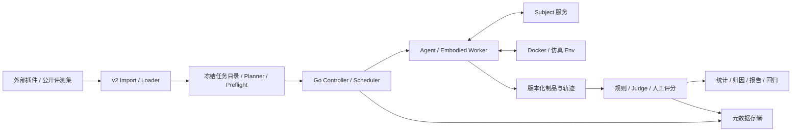

# Detroit：Go 评测内核优化设计

> 基线：feat/go-kernel，433d4ba；更新：2026-10-15。
> 本文是针对当前 Go 分支的设计优化，补充并修订 docs/01–10 的相关约定。下文“目标”尚未全部写入 Go / protobuf / 数据库，现状以 [README](README.md) 为准。
> 保留本分支已确认的 Go 控制面、Worker / Subject 协议、Agent 与具身双垂类，以及评测集 v2 的题目与评分独立版本。此前 TS / Bun / Bubblewrap 方案不适用于本分支。

## 1. 完整目标与当前基础

Detroit 使用统一的 Task / Env / Subject / Episode / Scorer 抽象，支持 LLM Agent 与具身策略的可复现评测、统计比较、失败分析和回归验证。Go 控制面管理计划与调度，Worker 执行环境循环，Subject 服务提供模型或策略动作；具身 Worker 与模型适配可使用 Python，通过 gRPC / Protobuf 隔离语言及依赖。

Agent 支持对话续写 next_message 和多步任务 episode，数据由 CasePick 等外部插件、自定义任务或公开 benchmark 提供。具身方向接入 LIBERO / LeRobot 等环境和 VLA / openpi 策略，复用调度、存储、统计与报告；当前 v2 的具身 task 载荷尚未定义。

当前已实现的闭环是：RunSpec → Synthetic Loader → Plan → SQLite → 租约分发 → Mock Executor → 结果入库 → JSON 汇总与 Wilson 区间。Docker 沙箱是独立组件；v2 Schema 和示例已存在，但尚无 Go v2 导入器、真实 Subject / Agent Worker 或具身 Worker。

本轮交付为设计和文档修订，不修改运行时代码或生成协议。目标简历介绍见 [PROJECT-PROFILE](docs/PROJECT-PROFILE.md)，Mock 验证与真实模型或机器人实测分别说明。

## 2. 优先解决的断点

| 优先级 | 当前代码证据 | 问题 | 优化方向 |
| --- | --- | --- | --- |
| P0 | internal/workerkit/workerkit.go | Execute 完成立即移出 active，Report 未 ACK 就停止续租；报告重试仅在内存 | 持久化 outbox、reporting 生命周期、恢复后先补交结果 |
| P0 | proto/detroit/worker/v1/worker.proto、store.Report | 只有 episode_key，接受第一个到达的结果，无法区分旧租约与新尝试 | attempt_id、worker incarnation、lease_epoch、原子有效性检查 |
| P0 | scheduler/plan.go、core/episode.go | taskset_hash 只进 manifest，身份不绑定内容；Worker 重新 Load 来源 | 冻结任务与初态内容，Worker 按摘要取包，续跑检查漂移 |
| P0 | store/schema.sql | 每 episode 只有一行 result，无独立评分历史与尝试成本 | Episode、Attempt、ExecutionResult、Evaluation 分离 |
| P0 | docs/10 | 摘要投影和评分阈值存在歧义，小版本兼容与严格 schema 有冲突 | 明确正向摘要投影、未知分项及版本兼容语义 |
| P1 | store/query.go、stats | 条件成功率与 Wilson 已有，但无有效性阈值执行、配对或依赖分组 | 保留已确认口径，补齐完成度、有效性、评分分组和推断条件 |
| P1 | workers/agent/sandbox | 磁盘为事后检查，销毁失败与截断采集边界需收紧 | 全程资源监督、可重试清理、原子产物清单 |
| P1 | RunSpec / Registry / proto | 评分、比较与 Subject 接口存在，实际仅 synthetic/mock | 能力预检；解析成功不等于该功能已执行 |

这些是基于当前源码的设计评审。现有测试覆盖的“结果只入库一条”不等价于“任务只执行一次”；真实模型的非确定性也不能由确定性 Mock 测试验证。

## 3. 架构与扩展边界

| 边界 | 职责 |
| --- | --- |
| Producer | 在外部生产题包，按 v2 交付；不承担平台调度 |
| Import / TaskSetLoader | 校验、转换、冻结题目与评分，保留原始版本及转换损失 |
| Planner / Preflight | 解析任务、初态、扰动、Subject、评分器、环境与预算能力 |
| Scheduler | 派发 Attempt、维护租约与状态、提交结果、控制重试政策 |
| Worker / Env | 独立恢复起点、执行观测动作循环、停止与收集，运行在线检查 |
| SubjectAdapter | Describe / Reset / Act / ActBatch，返回动作及可观测配置 |
| Scorer / Analyzer | 独立评分、校准后的候选归因、人工复核，保留证据引用 |
| Aggregator / Report | 按固定样本与评分选择规则计算和展示，不修改原记录 |

保留 Subject 服务化与跨语言适配，不把模型 SDK 或仿真器细节塞进控制面。Worker 声明支持的 horizon、task.kind、运行环境、观测动作 schema、GPU 与资源；不仅按 agent / embodied 字符串分配。

模型变化由 Subject 配置或多个 Run 的 ComparisonSpec 表达。Variant 保留原含义，即相机、布局、语言、工具故障等受控扰动，不与 Subject / Harness 版本混用。

SQLite WAL 作为单控制面起点，多 Worker 可远程执行。多机共享制品后端与 PostgreSQL 是独立演进阶段；迁移数据库本身不表示已实现高可用控制面。单机默认回环地址，开放远端时补充认证、传输加密和制品访问凭据边界。

## 4. 任务冻结、身份与版本

### 4.1 从 v2 到运行时

导入先校验 JSON Schema，再做 JCS / blob 摘要、评分绑定、工具消息配对、引用与来源用途等语义检查。没有环境或判分依据的包可以作为不可运行资料保存；不能通过导入动作调用模型、准备工程或执行测试。

冻结目录记录 dataset/case/scoring 的上游身份和修订、task_digest、评分摘要、原始包摘要、loader 版本、来源分组与材料清单。对外摘要采用 docs/10 的 RFC 8785；Go encoding/json 的确定性序列化不能直接冒充跨语言 JCS。

目标 ExecutionPlan 包含任务和初态快照、Subject 版本及配置、扰动定义、环境镜像 / 配方摘要、seeds / repeats、预算、重试与停止策略，以及初始评分引用。加载器版本与解析结果参与摘要。不能只把任务 ID 或镜像 tag 当作不可变内容。

Worker 领取的是冻结引用与预检要求，按摘要读取本地缓存或制品服务并重新校验；不得重新访问可变来源后默默使用新内容。任务列表、原始顺序及源组也固定，避免相同参数重提时新增或替换题目。

### 4.2 区分三种身份

| 身份 | 用途 |
| --- | --- |
| spec_digest / plan_digest | 描述配置和解析后的具体执行条件，可跨实验比较 |
| run_id | 一次实验实例；相同配置的新实验可以有不同 ID |
| submission_key | 网络重试同一提交的幂等键；同键不同计划须拒绝 |

当前代码由 RunSpec 哈希推导 run_id，重复提交还会重新开放 cancelled run。目标增加明确的新建 / 继续语义：同一请求重传不自动复活取消实验；继续只能引用原计划，新实验另外分配身份。迁移保留旧 ID 并标注 legacy 身份策略，不能重新解释历史键。

Episode 代表一份冻结计划中的一个统计位置：任务、扰动、初态、Subject、seed、repeat。Attempt 是它的一次实际执行，自动重试新增 Attempt，不增加统计样本。任务输入与评分各自版本化；重评分只产生 Evaluation，不重建 Episode 或调用 Subject。

## 5. 租约、提交与重试

### 5.1 结果选择代替“先到先得”

目标租约标识至少包含 episode_key、attempt_id、lease_epoch、worker_id、worker_incarnation 与服务端截止时间。每次重新派发递增 epoch；Worker 重启生成新 incarnation，避免复用 worker_id 让旧进程续租。

Heartbeat / Report 携带这些标识。数据库在一个事务内校验当前所有权、有效租约、运行取消代次和结果摘要，再确认提交：

- 当前有效 Attempt 的首次完整上报可以成为 Episode 的选定执行。
- 相同 attempt_id 与相同结果摘要重复上报返回已有 ACK。
- 同一身份的不同内容是冲突，不能直接返回 duplicate。
- 已失效、被替代或取消后的迟到上报保留为审计记录，不覆盖选定执行；其费用仍须记录。
- 允许补交的时间窗口与是否继续延长 reporting 租约写入政策；到期后不能凭旧 token 自行恢复有效性。

fencing 保护结果提交与受控资源写入，不能保证旧 Worker 或远端模型请求物理上立即停止。总体承诺是可能重复执行、可识别每次尝试、按规则只选择一个统计结果；不宣称端到端 exactly-once。

### 5.2 Worker 的提交阶段

目标状态：leased → preparing → running → collecting → reporting → acked；stopping、lost、cleanup_pending 分别记录。

执行结束后，Worker 先把结果、产物摘要、Attempt 身份和待提交请求持久化到本地 outbox，再进入 reporting；在允许的租约期内继续保活。只有获得可持久化 ACK 后才删除待提交项。重启先核对 outbox 与服务器状态，再决定补交、归档或领取新任务。

执行资源可在进程已停止后释放，但待确认结果有单独的有界队列和背压；不能把释放 GPU / 沙箱等同于忘记租约。RPC 设置 deadline、退避和可重试错误集合，避免单次阻塞令 Worker 无限失去响应。

网络中断时按保守租约余量停止新的动作并尝试回收沙箱。本地单调时钟用于经过时间，服务器时钟负责租约判定；不能信任跨主机绝对时钟完全同步。恢复连接后必须核对 epoch，不能续跑旧身份。

### 5.3 自动重试与取消

保留本分支的有上限基础设施自动重试目标，但将 MaxAttempts、可重试原因、总预算、退避和清理要求冻结到计划，不由控制面重启后的默认参数改写。报告传输重试不等于重新执行；未知远端完成状态不能按“从未调用”处理。

Subject 超时不自动意味着安全重试：无状态推理可能重复计费，有状态会话还可能已推进。适配器声明请求幂等、状态查询和取消能力；不支持时记录不确定执行并按政策终止当前尝试，不盲目重放工具副作用。

取消先持久化请求并停止派发，再通知 Worker；记录已受理、已停止和清理已确认。取消不消耗基础设施重试额度，不能在 lease 回收时悄悄变成 lease_exhausted。继续原实验须显式发起并先对账在途 Attempt。

调度容量按 Worker 当前有效的 preparing/running/reporting 数与资源占用计算，单次 Lease(max) 不足以防止连续调用超配。具身批推理额外限制显存与 batch 能力，保留每个 episode 的隔离状态。

## 6. 执行、环境与制品

next_message Worker 只调用一次 Act 并记录输出与工具调用，不执行工具，也不要求凭空构造沙箱。episode Worker 才负责 Act → 工具或环境推进 → 下一次观测；两者共享任务引用、日志与评分协议。

Subject Describe 需要可验证的协议 / 载荷版本、状态管理方式、参数及预算可控性、批量能力。运行记录分别保留 requested / applied / observed / unknown，不能把请求了某模型、seed 或温度当作已观测生效。Reset 绑定 Attempt；有状态 Subject 的超时与取消必须有明确会话结束策略。

Docker 后端继续负责只读系统层、独立工作区、网络、CPU / 内存 / PID 与超时。当前 DiskMB 为事后 du 检查，目标才是配额或持续 watchdog；整个 episode 的墙钟由独立监督器控制，不能仅依赖单次 Exec 超时。

Destroy 只有在容器与后台进程确认回收后才写 cleanup_done；失败进入可重试 cleanup_pending。资源带 run/attempt/owner 标签，启动时可对账残留。远端多 Worker 场景不能假设 artifact_uri 是所有节点都能访问的本地路径。

目标 ArtifactManifest 保存原始字节摘要、文件类型、权限、路径 / 工作区、大小、采集完整度、截断与错误；图像、视频、二进制和仿真终态有同一引用语义。先暂存再校验、最后提交清单，禁止截断 stdout 或中断导出冒充完整证据。

每个评分器声明证据依赖。缺少诊断附件只影响诊断；缺少必要评分输入使相关项 unknown 或 scoring_error。文件确实缺失与采集失败必须区分；产物哈希只证明字节一致，不证明来源可信、语义正确或模型行为可复现。

## 7. 执行结果、评分和报告分离

目标数据模型由 runs / plans、episodes、attempts、execution_results、artifact_manifests、evaluations、labels、report_specs 构成。执行结果记录停止原因、资源与产物；Evaluation 记录 task_digest、scoring_digest、评分器 / Judge / 环境版本、证据摘要、分项结果和用量。

保留 v2 每条要求 pass / fail / unknown，以及单独的评分器故障。必过失败直接判失败；已知全部必过通过且完整门槛已满足才判通过；加分未知不补零、不删权重后计算整题成功。全部已知但低于门槛应判失败。详见 [协议 §7.4](docs/10-dataset-format.md#74-判定与组合)。

scorers.select: all 只对同一执行证据展开多个 Evaluation，不复制执行次数，不把多份评分当作更多独立样本。各评分标签独立报告；每题评分规格由 ReportSpec 固定，可合法汇总预先定义的异构评分方案，但不能在同一题的 A/B 中临时混版。

在线评分依赖环境实时状态，先在 Worker 的受信任评分进程内执行并保存输入与环境信息；离线评分读取冻结制品。若在线检查所需的原终态既未保留、也无法从持久化快照恢复，则标记不可重评；只有仍具备可验证的原终态时才允许重跑评分，不能宣称所有评分均可无损离线复现。

重评分新增记录，保留历史，不重跑被测 Subject；模型裁判会新增评分调用成本。确定性缓存键包含证据和评分规格；随机 Judge 的重复执行有独立 evaluation_run_id，不能把不同随机结果当作重复写入覆盖。

Judge 与规则结果分别展示，使用人工标注集检查一致率、混淆矩阵及 κ 等适用指标，并检验位置、长度和模型同源偏差。标注来源、分歧、证据与裁判版本保留；模型给出的失败解释只作为候选归因，不能直接声称因果关系。

## 8. 统计与有效性

保留本分支已确认的主口径：N = 成功数 S + 失败数 F，条件成功率 = S/N；unknown 与 infra_error 分开计数、不加入 N，也不视为模型失败。它描述“已获得有效判定的样本”，不能自动代表完整计划。

每个报告同时给出 planned、pending、running、terminal、N、unknown、infra_error、取消数量、完成度及对应评分版本。目标有效性规则保留 infra_error 默认 5%、unknown 默认 10% 的门槛，分母与阈值写入 ReportSpec；最终报告按计划样本数计算缺失比例，未结束的运行只给 provisional 状态。代码当前尚未执行这些阈值。

N=0 时 rate 未定义，不显示 0% 成功率；区间也应有 defined 标志。区间字段使用 method、confidence、lower、upper，避免可配置置信水平仍叫 ci95。区间不能表示由选择性缺失造成的偏差。

Wilson 仅适用于相应独立二元采样条件。同题重复、同源任务、初态和扰动间相关性需在统计单位中表达；配对二元比较可采用满足条件的 McNemar，来源成组或加权比较采用另行验证的配对分组方法。不能把所有 episode 摊平后当作独立任务。

完整固定采样下，单题 n 次独立同分布执行、c 次成功且 k≤n，pass@k=1−C(n−c,k)/C(n,k)，pass^k=C(c,k)/C(n,k)。指标不能在排除未知后悄悄改用更小的 n，再声称原计划下无偏；提前停止或结果相关补跑同样需要单独说明估计对象。

作为主条件成功率的补充，可展示固定计划的缺失敏感性范围：令 M 是未取得有效判定的计划位置，成功率范围为 S/planned 到 (S+M)/planned。它不替换 D5 / §13 的已确认口径，不填补标签，也不是置信区间。对业务加权和多次尝试指标按预定规则逐题求界，再汇总。

比较报告固定 task / 初态 / 扰动 / Subject 配置、评分版本、采样与价格口径。任务相同与 seed 相同有助于对齐条件，但不保证服务端随机性一致。费用区分已知、估计、未知；所有 Attempt、重复远端请求和 Judge 调用按实际观测计入，不能只统计被选中结果的成本。

输入完整度按 tools.source 和 system.status 分组，按 source.group_key 处理来源相关性与改进 / 验证用途。对转作改进的材料保留历史并阻止继续以未暴露独立验证集名义使用。

## 9. 双垂类验收与实施顺序

首个真实闭环先选择一类 Agent 任务：v2 包 → 冻结计划 → Worker → openai-compatible Subject → 独立评分 → 制品 → 报告；随后用 next_message 与 episode 两种 horizon 验证契约。数据集转换、导入、可执行、评分忠实及公开口径兼容分别验收。

具身阶段复用以上控制面，增加仿真初始化、观测与动作 schema、策略服务、子目标谓词、视频和扰动套件。锁定任务、初态、模型、动作语义、环境与种子，使用零动作 / 脚本策略检查流程，并与同条件上游评测对照。置信区间重叠本身不能证明实现等价；差异需查明并披露。

优先级依次为：可靠性与冻结身份 → v2 导入和真实 Agent → 评分版本与统计 / Judge / 回归 → 具身标定与扰动 → 多机吞吐与部署验证。详细交付条件见 [路线图](docs/08-roadmap.md)。

关键故障验收：Report ACK 丢失、控制面断网、旧 epoch 迟到结果、Worker 重启 outbox、取消与上报竞争、任务源漂移、未知评分、产物截断、Destroy 失败后重试；每类都需要明确期望状态与成本归属。

## 10. 文档与迁移约束

[docs/01–10](docs/01-overview.md) 继续作为当前 Go 双垂类设计体系，已在相关章节补充优化规则；不将它们整体标为废弃。冲突处以本轮有明确说明的修订为准，不能据此推断 proto、schema 或代码已经同步实现。

协议升级需增加版本协商、能力检查和混合版本拒绝策略，原有字段号不复用。旧 episode 结果只能迁移成标明来源和观测限制的 legacy Attempt，不能补造从未记录的重试历史、费用或任务快照。迁移采用显式版本和短事务，保留备份及可核验回滚步骤。

依据：RPC deadline 不能证明服务端未执行，[gRPC 状态码](https://grpc.io/docs/guides/status-codes/)也要求按业务幂等语义选择重试；过期租约持有者仍可能运行，需由受保护资源检查代次，可参考 [etcd 的 fencing 示例](https://github.com/etcd-io/etcd/blob/main/contrib/lock/README.md)。这些用于论证设计，不表示项目已引入 etcd。
