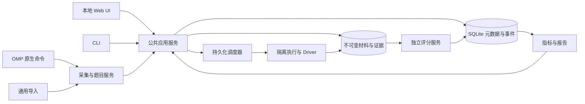

# Detroit 本地 MVP 设计草案

状态：**待用户审阅，尚未进入实现。**

[范围共识](../CONTEXT.md)记录用户已选择的产品规则；[术语表](../GLOSSARY.md)记录已明确的领域含义。本文给出满足这些规则的工程建议、事实依据和验收设计，不把建议写成已接受决定，也不把接口核查写成已实现功能。历史 README、M1、DESIGN 和访谈记录保持不变；不继承其中与本轮范围冲突的假设。

## 1. 产品闭环与边界

用户把日常真实问题保存为题目，确认复测材料与验收方式，在同一 Harness 下比较模型，查看可追溯的失败证据，再把需要保留的问题整理进回归集合。保存与执行分开：保存不要求材料已经完整，也不启动模型、项目脚本或判分程序。

首版是 Linux 单机工具，提供本地 Web UI、CLI、OMP 原生采集和通用题目导入。任务契约不以代码题为唯一形态：可评价文本、结构化输出、文件产物、命令结果和用户授权的执行轨迹。代码项目只是其中一种材料与执行环境。

首个真实实验固定 Harness、比较两个模型。完整任意 Harness 生态接入、企业多租户、云同步、社区、自动训练、智能扩题和自动失败诊断不属于本轮承诺。用户自带模型裁判属于评分器接入，不等于平台内置或已校准的裁判。

可观察的推理输出或轨迹可以作为评分输入；模型不提供的内部 CoT 不可采集，也不能用 reasoning token 数量代替内容。失败证据能支持人工定位，不自动证明某个组件就是失败原因。

## 2. 部署与模块边界

建议复用仓库已有 TypeScript / Bun、SQLite、JSONL 事件和证据摘要模式，采用本地模块化单体，不引入微服务。Web 与 CLI 调用同一应用服务，不能各自实现一套实验或判分语义。

模块职责：

- **采集与材料**：用户批准的消息、文件、附件、起点与来源；完整性检查，不执行任务。
- **题目与数据集**：草稿、冻结版本、评分引用、用途分组、业务权重和已知暴露记录。
- **执行**：准备环境、恢复基线、执行完整尝试、预算、中止、进程回收、产物冻结。
- **评分**：规则组合、模板、自带程序、人工判分、评分版本与重新判分。
- **报告**：计划槽位、成功/失败/未知、指标、费用来源、不确定性和比较限制。
- **回归整理**：从失败记录确认保留题目与修改，维持来源关联；不生成未经确认的标准答案。

默认服务器只监听 loopback。状态变更请求校验会话令牌和来源，防止其他网页借 localhost 发起执行；下载按材料 ID 授权，不提供任意主机路径读取。用户访问本地 UI 不等于授权执行导入文件或发送数据给外部服务。

## 3. 身份、版本与数据用途

建议采用以下持久对象，而不是继续让一个代码题对象承担所有职责：

| 对象 | 职责与不变量 |
| --- | --- |
| SourceGroup | 同一真实问题的来源关联；用于用途分组和已知泄漏检查，不合并独立题目的统计权重。 |
| Capture | 一次批准的现场记录：会话/消息/起点、材料清单、诊断关联、缺失项；不是可运行承诺。 |
| Case / CaseDraft | 稳定题目身份与可编辑草稿；保存失败现场不要求立即可评分。 |
| CaseRevision | 冻结任务起点、模型可见输入、材料和环境要求；执行引用具体版本。 |
| ScoringSpecRevision | 独立冻结规则、模板配置、评分器代码/版本、私有验证材料和组合方式。 |
| DatasetRevision | 冻结题目版本、评分版本、用途、业务权重及来源分组。 |
| ExperimentSpec | 冻结数据集引用、候选配置、Harness、每题 N、共同 k、停止策略、顺序和预算。 |
| TrialSlot | 计划中的某题×候选×重复序号；未运行也存在，不能从分母消失。 |
| Attempt | 槽位的一次完整任务执行；补跑创建新 Attempt，不覆盖旧执行。 |
| Evaluation | 某份冻结证据按某评分版本的一次判分；保留评分来源、错误、人工修改和费用。 |
| Report | 引用明确的执行/评分选择及分析配置；重算产生新报告，不改写旧报告。 |

**版本拆分待审阅：**共识中的“冻结题目与判分定义”应解释为实验同时冻结两个引用，不必把判分定义塞进任务版本。仅修改评分规则时创建 ScoringSpecRevision，对已有证据重判；任务输入变化才创建 CaseRevision。这满足历史不变和不重跑模型的要求，但属于本文建议的具体建模方式，暂不改写术语表为已确认决定。

证据以内容摘要索引；材料清单包含相对路径、类型、哈希、权限及存在/删除状态。摘要算法与规范化格式带版本，路径和符号链接不能逃出批准范围。ID 负责身份，摘要负责内容一致性，不用内容相同推断两个真实问题就是同一来源。

改善集、独立验证集是用途；回归集合是保留与复测组织方式，不能把三者简单做成互斥枚举。默认用户按来源组手动分配，平台检查已知同源重叠。验证题用于优化时明确确认用途转换，记录整个关联来源组的暴露及时间；旧报告保留当时状态，未来报告不能继续称其未暴露。平台不承诺识别未知语义重复或模型训练语料中的题目。

## 4. 题目契约、导入与准备度

通用导入与原生采集归一到同一草稿契约，建议使用带 schemaVersion 的 JSON 清单和材料文件。核心字段：

- 任务说明、任务起点、来源组及来源引用。
- 模型可见材料、只用于诊断的旧记录、评分侧材料；可见性不能由所在文件夹名称隐式决定。
- 输出位置/格式或允许采集的轨迹；没有要求的产物不能擅自假设为成功标准。
- 工作区基线、运行时/工具依赖、用户批准的准备命令、联网与凭据能力。
- 评分版本引用；草稿可暂缺，首次评测引导补齐。
- 缺失材料、无法验证的起点及准备阻塞原因。

准备度是多个独立维度：草稿/冻结、材料完整性、环境可恢复性、评分可用性、用途/暴露。不能把“已经保存”显示成“已经可运行”。

冻结前检查所需输入、依赖、输出契约、评分输入和执行能力；只缺非必需诊断材料不阻止运行，缺必需起点或依赖则阻止该题。准备脚本只能在明确授权后、隔离环境中运行，不能因保存或导入自动执行。不支持的材料或运行时明确报阻塞，不降级到主机项目。

## 5. OMP 原生保存与文件起点

### 5.1 已核实的接口

OMP v18.8.3 原生扩展支持 registerCommand、ctx.cwd、只读 sessionManager 的 getSessionId / getLeafId / getBranch 等接口。[扩展文档](https://github.com/can1357/oh-my-pi/blob/v18.8.3/docs/extensions.md)与[会话实现](https://github.com/can1357/oh-my-pi/blob/v18.8.3/packages/coding-agent/src/session/session-manager.ts)提供依据。

建议实现显式 `/detroit-save` 命令：读取当前会话所选分支，让用户选择原始任务起点或当前卡点，预览并确认消息、文件及附件范围，然后只保存草稿。不是 LLM 可调用的自动导出工具；不得调用 sendUserMessage、compact、handoff 或模型来完成保存。无 UI 时必须要求明确的批准参数或拒绝保存，不能把对话框默认值当成同意。

会话分支与 Git 分支是不同对象。保存记录选中用户消息 ID、父消息、当前叶 ID、会话 ID、OMP 版本及批准材料；不默认复制所有历史分支、整个会话目录或 HOME。引用附件只复制批准项，旧尝试默认留在诊断侧。

### 5.2 不可混淆的恢复边界

原生 checkpoint / rewind 的实现记录消息位置并裁剪/分叉会话，**不是文件系统回滚**：[checkpoint 工具](https://github.com/can1357/oh-my-pi/blob/v18.8.3/packages/coding-agent/src/tools/checkpoint.ts)、[会话执行](https://github.com/can1357/oh-my-pi/blob/v18.8.3/packages/coding-agent/src/session/agent-session.ts)。hashline 编辑快照也不是完整、持久的历史工作区备份。

因此：

- **当前卡点**可保存批准的当前工作区状态和用户明确选择的上下文。
- **原始任务**需要可信的原始文件快照、明确的提交基线及必要的未提交材料，或用户提供的可验证起点。不能从当前文件和聊天记录假装重建任意历史状态。
- 没有原始材料仍可保存，标记 missing_start_snapshot 等具体原因；复测保持阻塞，不能偷偷切换为当前卡点。
- 同一问题的两个起点创建关联但独立的题目，分别执行和计权，来源分组控制用途隔离。

建议为未来任务提供用户主动启用的起点记录：先批准工作区范围，再由 input 等合适原生钩子在任务派发前保存本地基线。必须区分主代理/子代理、队列入站/实际派发和重试，避免重复快照。该能力不追溯修复历史缺失。

快照读取并非自动原子操作。只在可确认的静止点捕获；外部编辑器或后台程序可能并发改动时标记不一致并阻止复测。排除运行目录和明显秘密只是预防措施，不保证无敏感内容；确认预览仍必要，不能遍历越界符号链接。

### 5.3 独立执行与实际配置

每次尝试恢复 Detroit 冻结的批准基线到新工作区，用新的 OMP 进程、HOME 和会话执行。不能 fork/resume 日常会话替代独立样本，也不能只 new_session 而继续使用已经改过的目录。

[RPC 文档](https://github.com/can1357/oh-my-pi/blob/v18.8.3/docs/rpc.md)区分 prompt 接收、prompt_result 和 session_settled。Driver 必须按请求 ID 关联完成并确认后台工作停止，不能只等第一个 agent_end。协商支持的协议版本，按文档校验分块/上限，逐步保存已完成消息，不把截断的末尾事件当完整轨迹。

配置分为请求值、平台实际应用值、原生观察值和未知值。支持才应用，不支持则阻止或明确标为不可比较条件；不回显请求值冒充实际配置。模型目录中的同名温度不保证跨模型等价，差异与来源要记录。

可用 native hooks 与最终消息观察请求元数据及 usage；日志白名单禁止保存完整带密钥的 headers/payload。钩子观察可能不是最后一次改写后的线上请求，必须标注阶段。provider 上报、OMP 目录估价、缺失字段分开记录；原生事件计数也不能无条件等于每个 HTTP 重试或账单请求。辅助调用、子代理、缓存预热去重后计入，无法观察的部分保持未知。

## 6. 评分规则、接口与隔离

结构化规则选择具体评分输入及条件，平台不靠 LLM 生成必需代码。首版模板：字段存在/类型/结构检查；文本、文件及文件清单检查；命令/测试验收。模板、配置和自带脚本都冻结版本；评分侧输入包含证据摘要和所需材料，不默认给评分器所有用户历史。

建议外部评分程序接收版本化 JSON 请求，返回逐规则的 pass / fail / unknown / error、分项数值与范围、理由和证据引用。stdout 协议与诊断 stderr 分开，限制大小、运行时间及格式；格式错误、程序崩溃或依赖缺失是评分器错误，不是候选任务失败。命令模板要显式约定哪些退出码代表断言失败，哪些代表基础设施错误，不能把任何非零退出码都判为任务失败。

组合语义：

1. 任一必需条件已确认失败，整体可确认 fail，即使其他分项还待判；故障仍单独展示。
2. 所有必需条件，包括用户选择参与整体通过的分项/综合阈值，都已确认通过，整体才是 pass。
3. 尚有必要条件未知，且没有确认失败，整体为待判；不能把未知分项填零或去掉后重新归一化。
4. 非必需分项只用于分析，不暗中改变整体通过标准。综合分缺项则保留缺项，不能显示伪完整分数。

候选工作区不包含私有答案及验证材料；用户明确选择的自测材料例外，并进入冻结条件。规则公开到什么程度由题目确认，不能为了藏答案把用户要求公开的验收条件也藏掉。

评分读取冻结候选产物，候选不能继续写；评分器自身使用独立 scratch。若测试会执行候选代码，子沙箱不带凭据或标准答案，可信协调器在外部比较结果。任意外部测试框架不能自动保证隐藏检查器对恶意候选代码不可见；需要显式声明其材料暴露能力，不能把只读挂载当成禁止读取。平台不是任意不可信社区程序的零风险宿主。

人工判分记录评分版本、操作者及理由；正式比较隐藏模型标签并打乱顺序，但内容自带身份线索的风险仍披露。自带模型裁判另记裁判配置、可观察 usage 与校准状态；默认没有被平台证明可靠。

评分规则变更先对既有冻结证据重判，不重跑任务模型。缺必需产物则明确提出重新执行，由用户选择。重判仍可能调用用户的收费裁判，应单独提示预算。确定性评分可按证据和评分版本去重；随机裁判或人工复核保留不同 Evaluation，不以输出不一致当作存储冲突，也不能择优挑一份评分。报告冻结其采用的评分记录与修订方式。

已知正负样例用于检验评分器：错误实现应失败、正确实现应通过，必要时加入针对规则漏洞的边界样例。校准结果不混进模型成绩。

## 7. 调度、预算与恢复

先持久化计划槽位，再开始执行。正式比较在同一题/重复序号内配对，各模型交错执行；保存顺序及调度随机种子。种子是调度复现依据，不保证供应商模型随机数一致。每个尝试独立恢复起点，前次答案和改动不能流入下一次。

Attempt 的状态与 TaskVerdict 分开：成功退出、超时、取消、启动故障描述执行；pass/fail/待判描述验收。超时确认进程停止后，仍根据已有产物判分；只有明确的按时完成条件才因超时直接失败。不可判的部分保持未知。

暂停阻止新派发；取消停止执行与未授权后续工作；崩溃后的恢复先核对进程归属和存活。仅凭 PID 不足以判断旧执行，需记录运行身份、进程启动标识和监管关系，避免 PID 复用及重复执行。未确认停止的工作区不冻结、不重跑。主动取消不自动恢复，用户选择继续未启动槽位或补跑故障。

补跑为同一槽位建立新的 Attempt，保留原故障和全部成本，固定配置，不挑最好结果。已完成的有效样本不因结果不好而补跑替换。恢复不重开终态 Attempt，也不重复计数。报告披露补跑协议；填满槽位不自动消除结果相关缺失或选择偏差，不能据此直接恢复独立同分布推断资格。

控制能力在启动前展示：尝试数、墙钟时间可控；模型调用、token、费用控制依赖 Driver 的观测与中止能力，未知不得标为零，软界限不能写成硬保证。任务模型、评分模型与辅助调用分别记账；只有部分已知时显示已知小计，不伪造完整账单。

总预算耗尽不删除已有产物或成绩。未运行槽位、未完成且不可判的部分仍未知；已有可判证据保留。收费评分若未获预算不能偷偷继续，应等待用户授权判分，而不是记任务失败。

## 8. 统计协议与适用范围

### 8.1 固定计划与两个指标

完整尝试是采样单位，不是一次模型 API 调用。对同一题、同一候选及冻结条件，计划 N 次；正式报告冻结共同 k 列表，要求所有题的计划 N 支持每个 k，不静默跳过题或降低 k。

完整独立同分布二项样本中成功数为 c，1 ≤ k ≤ N。建议采用文献估计量，其中组合数 C(a,k) 在 a < k 时为零：

- pass@k：H_at(N,c,k) = 1 − C(N−c,k) / C(N,k)。
- pass^k：H_all(N,c,k) = C(c,k) / C(N,k)。

同一组样本用于两个指标，不额外做一次 k 连跑。前者估计至少一次成功，后者估计全部成功；不能简单用 (c/N)^k 代替后者。[HumanEval](https://arxiv.org/html/2107.03374v2#S2)及其[实现](https://github.com/openai/human-eval/blob/master/human_eval/evaluation.py)支持 pass@k；[τ-bench](https://arxiv.org/html/2406.12045v1#S3)讨论 pass^k。

独立同分布是推断条件，不是由“换目录”或“交错执行”自动证明。供应商版本漂移、限流、缓存和外部服务变化都须记录。报告结论限定于冻结题目、权重和条件，不自动推广为某领域整体水平。

### 8.2 缺失与业务权重

每个单元保留 N = c + f + u；u 包括未运行和整体未确认的槽位，同时展示各原因。对任一 H，计划完成上下界为：

[H(N,c,k), H(N,c+u,k)]。

这是把未知全按失败/成功补全后，**计划样本估计量的确定性界限**，不是总体成功概率置信区间，不能叫“95% 区间”。已确认整体失败但分项待判的样本计入 f，附带分项待判说明。

数据集使用冻结业务权重 w_i，归一为 a_i = w_i / Σw_i，Σw_i 必须为正；零权重仍显示题目状态。对各题点值或端点求 Σa_i H_i；不能按尝试数或只按完整题重新加权。比较 B−A 的缺失界为 [B_low−A_high, B_high−A_low]。

例：N=4、c=1、f=1、u=2、k=2 时，pass@2 的完成界为 [0.5,1]，pass^2 为 [0,0.5]。全未知为 [0,1]，不能显示为 0%。

### 8.3 停止策略与不确定性建议

保留用户配置的停止策略，但不把“首次成功就停”等结果相关停止后的前缀当成固定 N 无偏样本。计划 N、实际顺序、停止原因与缺失界仍显示；该报告不能无条件提供固定样本推断。快捷复测可以使用早停；正式实验使用早停时，也必须显式标记相应推断不适用，不悄悄改用户策略。

建议首版正式固定样本推断采用保守的 Clopper–Pearson 二项区间，而不是照搬历史方案的题目 bootstrap。用户的题目与业务权重是固定评价目标，不是随机抽取的总体样本。

具体技术提议：对预先声明的 M 个题目×候选单元，取整体 α=0.05、单元 β=α/M。完整单元：c=0 时 L=0，否则 L 为 Beta(c,N−c+1) 的 β/2 分位数；c=N 时 U=1，否则 U 为 Beta(c+1,N−c) 的 1−β/2 分位数。依据为 [NIST 二项精确区间](https://www.itl.nist.gov/div898/software/dataplot/refman2/auxillar/exacbici.htm)及[Bonferroni 界](https://www.itl.nist.gov/div898/handbook/prc/section4/prc473.htm)。

把 p 端点变换为 1−(1−p)^k 或 p^k，再做业务加权及候选差值端点运算；不能把概率端点塞进组合数估计量。预先声明的单元同时覆盖支持这些固定变换，不需要把每个 k 再机械增加一次校正。此方案不利用配对协方差，可能很宽，但不要求跨单元独立；单元内部的二项假设仍需要。

缺失时，若固定计划的潜在结果与二项假设仍有合理解释，可另外报告 [L_CP(c,N), U_CP(c+u,N)] 经上述变换得到的保守包络，并明确它同时包含缺失与采样不确定性。若停止或环境变化使这些假设不成立，不显示伪精确概率区间，只显示计划完成界与条件说明。

全部成功/失败不代表总体概率恰为 1/0。差值区间覆盖零不等于两模型等效。来源相关性、未知使用历史、评分器可靠性也不能靠该统计区间解决。α、推断方案与比较范围在实验前冻结；这里的选择仍待设计审阅。

## 9. Web 与 CLI 的交互设计

关键页面与同语义 CLI 能力：

- **保存入口/题库**：起点、材料预览、旧记录可见性、来源与缺失状态；支持先存后补。
- **题目编辑**：任务输入、环境、输出契约、结构化评分、私有材料、正负校准；冻结前显示阻塞项。
- **数据集**：来源组、用途、回归集合、业务权重与版本；验证题转为优化用途时明确提醒关联暴露。
- **实验设置**：快捷复测/正式比较，候选实际支持的配置、每题 N、共同 k、停止策略、预算及费用未知项。
- **执行视图**：计划与实际进度、成功/失败/未知、独立执行状态、暂停/取消/恢复；不把未跑题隐藏。
- **尝试详情**：原始任务、批准基线、实际配置来源、评分证据、产物、日志、运行错误与判分错误。
- **匿名判分**：正式比较的独立盲评队列，保留内容可能泄露身份的提示。
- **报告/回归整理**：固定评价范围、两个指标、缺失界与适用的推断、费用来源；选失败来源确认保留或修改。

回归整理默认可直接把现有题目版本加入回归集合；输入改动生成新版本，起点不同按关联题处理。不默认复制失败回答为标准答案，不自动把用于优化的问题放回独立验证集。

CLI 的具体新命令名在接口实现时确定，不在本文把尚不存在的命令列成可执行用法。现有运行/评分/报告能力按共同服务迁移，Web 操作返回相同的对象 ID 和版本语义。

## 10. 安全、资源与历史迁移

Linux 隔离继续复用已有 Bubblewrap 边界；启动检查失败即阻塞，不回退到主机。候选只读工具/运行时、独立可写工作区、清理后的环境；准备、执行、评分分别声明能力。需要联网时明确授权，现有 none/host 选择不能声称域名级出口限制。

只给确实需要的组件传所选提供方凭据，不传整套 HOME 或继承所有环境变量。建议受控环境注入代替 API key argv；同用户进程可读环境的风险仍存在，不声称绝对保密。执行候选代码的验证子进程不继承评分模型凭据。

文件数/总大小、单文件、轨迹、stdout/stderr、评分和执行时限需要明确上限；达到上限保留截断与缺失原因。内存、CPU、PID、工作区总量的硬限制是否实际可用要通过 capability probe 记录，不能把未实现字段当硬限制。快照保存本身不能无界复制项目。

SQLite 持久化计划、状态与不可变引用；长执行不占数据库事务。事件和证据写入失败不能假装运行已经可信完成。报告必须知道产物是否完整和清理是否完成。

现有 v1 是固定脚本题与二值判分。迁移保留历史记录和原语义，映射到标有 legacy 的版本对象；不能为历史尝试补造完整 usage、现场基线或真实配置。旧实验不被新默认评分自动改写；没有要求清空现有数据库或删除实现。

## 11. 验收设计：必须实际走通

以下是后续实现验收，不是本文已经完成的功能清单：

| 场景 | 必须观察的行为 |
| --- | --- |
| 日常 OMP 原生保存 | 在普通会话里选真实问题、起点与材料并确认保存；无额外模型调用，源项目不变；预写导入题不能冒充此项。 |
| 历史原始状态缺失 | 题目成功保存、具体缺失可见，复测被阻塞；当前状态不能偷偷冒充原始状态。 |
| 已授权起点记录 | 捕获可信基线，独立尝试从同一批准起点恢复；并发写入导致不一致时拒绝声称可复现。 |
| 输入/诊断/评分边界 | 旧失败与私有答案默认不进候选工作区；显式自测暴露进入冻结条件。 |
| 通用题目与模板 | 非代码输出题能保存/评分；结构检查、文件检查和命令验收有可信正负样例；评分程序故障不等于任务失败。 |
| 两模型真实实验 | 同一 Harness、冻结条件、独立起点、实际交错采样；调用由用户授权并受预算约束，差异/未知配置如实记录。 |
| 评分修订 | 换规则重判已有证据，任务模型不重跑；证据不足要求用户选择重新执行，保留旧成绩。 |
| 人工/模型评分 | 正式人工判分隐藏模型标签；自带模型裁判展示版本、未校准状态及可观察计费。 |
| 指标与未知 | 共同 k 检查、业务加权、c/f/u 和完成界；全成功/全失败、全未知、k>N、早停及分项待判不产生伪精确结论。 |
| 暂停/取消/异常恢复 | 先核对旧进程，终态不重开，不自动恢复主动取消，不重复派发；原故障与补跑费用均保留。 |
| 用途与回归 | 同源组检查、显式用途转换及暴露记录；从真实失败确认回归保留，失败答案不成为黄金答案。 |
| 可公开复现实验 | 一组合法可公开且有可信验收的真实任务，展示保存→整理→比较→证据→回归全链；校准样例另报，不要求首次实验一定改进。 |

## 12. 当前仓库差距与本轮证据

源码事实，不是对未来能力的猜测：

- [OMP Driver](../src/drivers/omp.ts)已有 RPC 任务执行，并修复 v2 协商、请求完成/后台 settled 关联、配置观测、凭据 argv 和有界白名单证据。modelCalls/toolCalls 是去重主会话身份的观测下界，辅助/子代理及完整账单仍未知；没有日常现场保存。请求中的 endpoint、温度及多数预算不支持应用时显式记录 unknown/unsupported，不回显为实际配置。
- [契约](../src/contracts.ts)目前围绕固定代码题、固定检查与有限重复数，未覆盖上述通用草稿、组件评分及独立版本模型。
- [存储](../src/store.ts)已有持久槽位/尝试/判分基础，但确定性判分一致性不能直接承担随机模型裁判和人工复核。
- [执行器](../src/runner.ts)已有冻结实验与题目内交错顺序，并修复执行原因/采集错误分离、部分产物完整性和清理未确认时停止派发；报告不再为评分通过的超时产物隐含增加失败条件，比较固定使用原实验评分版本。仍需实现通用现场基线、独立评分定义、组件未知和用户控制的继续/补跑语义。
- [验证器](../src/eval/verifier.ts)已有可信比较边界；[隔离实现](../src/sandbox/bubblewrap.ts)已有 Linux 工作区与网络选择，但 aggregateMemory、aggregateCPU、aggregatePids、workspaceQuota 等不能据此声称已硬限制。host 网络不是出口白名单。

设计阶段的接口与数学验证（以下保留原核查记录，不代表完整 MVP 已实现）：

1. 本机命令显示 omp/18.8.3。上游证据固定到 v18.8.3，未用本地旧版本缓存推断新版本能力。
2. 在无网络 Bubblewrap、空 HOME、不挂载用户 HOME、不提供真实凭据的临时环境，注册专用原生命令，实际读取会话身份、分支、cwd 和一份明确授权的合成文件。RPC 支持 [1,2]；命令完成 agentInvoked=false，before_provider_request 观察数为 0，没有 agent_start，文件哈希匹配且源文件未变，进程退出 0。
3. 无模型配置的首次启动未进入 ready，报 No default model selected。随后仅为目录模型选择注入非真实占位值并指定模型，网络仍物理隔离；不是一次真实模型评测。该探针证明扩展与读接口可用，不证明完整保存 UI、历史文件恢复或真实模型费用统计已经实现。
4. 临时数学程序验证 216 个精确无偏性恒等式、缺失界示例与非法 k 防护；612 个二项覆盖网格点、极端计数区间非零宽度和缺失包络包含性通过。首次成功早停的两次计划前缀，在 p=0.5 时平均成功比例为 0.625，展示固定样本公式不能盲套。

数学冒烟不是对全部参数的数值稳定性证明，也不是仓库统计模块已实现。上述设计核查未运行收费模型、真实问题保存全链或 Web UI；临时探针不作为产品代码保留。

之后按用户限定只修复既有实现，未实现本文列出的新能力。修复验证为 63 个代码测试通过、TypeScript/Biome/驱动构建通过，独立临时目录 CLI 完成 10 个 Bubblewrap 样本并实际检查浏览器报告；真实 OMP v18.8.3 断网无模型 RPC 协商与请求完成冒烟通过。详见 [M1 修复记录](M1.md)。这些证据不替代第 11 节的完整产品验收，也不是两模型真实实验。

## 13. 审阅重点与下一步

产品选择已足以形成闭环，不需要再追加零碎偏好问题。下一步是审阅本文的工程解释：任务/评分分版本、起点快照可证明性、评分能力边界、缺失与不确定性呈现、以及上述端到端验收。

新增能力审阅通过后再与用户共同制定实现切片和验收步骤；不提前写 ADR 把未批准的技术建议变成决定。本轮仅修复既有代码与上述约束冲突的行为，历史产品范围不因此被宣称已升级为完整本地 MVP。
